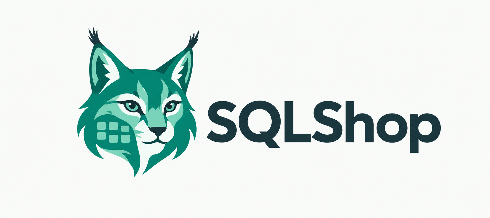

<p align="center">
  
</p>

# SQLShop

Rust 编写的本地桌面数据库工具，统一连接入口支持 MySQL、PostgreSQL、Microsoft SQL Server（MSSQL）和 Redis；关系数据库使用 SQL 工作区，Redis 使用专属键管理页面，另有 SQLite 文件与 Oracle 独立文档。无需注册产品账号；数据库使用其自身认证，Oracle需本机Instant Client。

## 本轮功能补齐

- 2026-10-23：查询编辑区和侧栏提供“保存查询 / 已保存查询”，支持命名保存、再次更新、另存副本及重启后保留关联；保护旧版本与 SQL 文件的保存目标。SQLite / Oracle 草稿恢复保持原引擎，覆盖未保存 SQL 前需确认。
- 修复 PostgreSQL 超长文本静默截断、JSON/XML 更新和旧值冲突判断，以及 MySQL 调度与 PostgreSQL 任务 / 恢复目标连接问题；新增完整输入、调度连接和草稿回归，设计器 / 取消用例加入 CI 实库流程。
- 表设计页新增字段改名、默认值、类型转换、生成列与主键/唯一/CHECK/复合外键管理；普通索引可选多列。修改先预览确认，执行前复查服务器定义。
- SQL编辑器支持格式化/压缩、绑定目标的schema/别名补全及只读折叠视图；网格支持列显隐、冻结、适宽，表的列设置随工作区保存。
- 工具菜单可创建Schema或新建视图/例程/触发器/序列；只读定义页可打开对象设计器。保存前核对旧定义，失败保留草稿。
- 表底条可停止普通分页与末页统计，取消后等待服务器响应；SQL标签停止继续保留。

本轮未扩展多格式导入导出及TLS证书配置。支持范围、剩余限制和专用三引擎联测记录见[实施计划](docs/sqlshop-rebuild-plan.md#2026-10-19-授权实施计划)。

## 新增管理工具

- 数据网格单击选格、拖动框选单元格，拖动行号选多行，Shift+单击扩展；双击/F2/Enter编辑。内容拖动不再滚动表格，滚轮、触控板和滚动条照常使用。
- 左侧表/视图旁箭头可展开字段、索引、外键、触发器。展开时独立读取目录；双击字段/索引/外键进入对应设计页，双击触发器看定义，右键表节点可刷新。
- 左树各层统一：整行单击选择、箭头展开，容器双击展开/折叠，表双击开数据；选中或右键不会强制离开当前文档。可用上下/左右/Home/End浏览、Enter打开，也可右键“打开数据/设计表”；树外输入不抢方向键。搜索展开只发生在文字改变时，不自动连接服务器或切库。
- SQL运行旁“停止”发送实际取消请求，等待服务器确认；“事务”菜单在此标签原连接开始/提交/回滚、核实状态或主动检查上下文。MySQL与SQLServer查询后使用协议观察数据库，保留ROW_COUNT/@@ROWCOUNT；SQLServer默认schema在连接或主动检查时读取。
- 表草稿断线/提交不确定时显示页内恢复核实：旧值、草稿和服务器当前值对照，手动继续/移除匹配/处理冲突，未知INSERT不自动重放。
- “工具”提供真实估算执行计划、活动会话/锁/累计查询统计、基础账号/角色/授权管理、官方工具备份恢复、两表数据/结构比较与安全范围同步、SQL调度。设计页“关系图”显示已读取外键。
- 比较同步每侧完整范围上限1000行，暂限同引擎适配主键/类型的UPDATE+INSERT；不删除目标独有行，复杂DDL及跨引擎自动转换未支持。备份工具需自行安装或指定路径，SQLServer文件在服务端，恢复只接受空/不存在目标，不兼容Navicat备份格式。
- SQL计划只在应用打开时执行；保存启用前确认连接/目标/SQL，连接配置改变、失败或中断均不会自动重跑；记录保存在`jobs.json`，不保存凭据，SQL为明文。
- “工具 → 打开/新建SQLite文件”进入独立会话与对象/SQL页；“Oracle连接与查询”填写服务/TNS与数据库凭据，提供对象定义、SQL文件、手动事务与停止。新增引擎尚未覆盖主工作区全部网格/设计器。
- SQLServer连接新增Entra令牌、命名实例UDP 1434发现；Windows构建另支持SSPI/Windows凭据。令牌不自动续期；SSH场景填写实际TCP端口。macOS/Linux Kerberos未接入。

完整范围、剩余差异与验收记录见 [功能清单](docs/sqlshop-rebuild-plan.md)；本轮表设计、对象保存和表取消已有专用三引擎联测，其他管理工具的验证状态仍逐项列出。

## 启动

需要 Rust 1.89 或更新版本。在项目目录运行：

```sh
cargo run --locked
```

首次启动点击左侧“新建”，在数据库类型中选择 MySQL、PostgreSQL、SQL Server 或 Redis，填写服务器地址、端口和认证信息。可以先“测试连接”，再“保存并连接”。连接时均无需选择数据库；SQL 连接后展开查看数据库和表，Redis 从 DB0 建立连接后在左侧连接树读取真实数据库列表（含空库），双击数据库进入键管理页面并切换 DB。

新建连接默认不启用 TLS，可按需勾选“启用 TLS 加密”；启用后默认验证服务器证书，使用自签名证书的服务器可以勾选“信任服务器证书”。已有连接保留各自保存的 TLS 设置。首版暂未提供自定义 CA 和客户端证书配置。

## 当前功能

按重要性排序的功能清单及“实现 / 复刻”状态见 [重建计划](docs/sqlshop-rebuild-plan.md#功能清单按重要性排序)，后续进度以该表统一更新。

### 菜单、查询库与连接分组

- 顶部采用“文件 / 连接 / 查询 / 编辑 / 工具 / 视图”菜单及快捷工具栏，可新建连接、新建查询、打开 SQL、命名保存查询、打开查询库、运行和刷新目录；“工具”打开诊断、计划、账号权限、备份、比较同步、调度及新增引擎文档。数据库操作使用后台线程、目标检查和会话切换确认。
- 查询编辑区的“保存查询”或 `Ctrl/⌘+S` 可将未绑定文件的 SQL 命名保存到查询库，连同标签的连接 / 数据库 / schema 一起保留；之后再次保存会更新该命名查询。`Ctrl/⌘+Shift+S` 可另存为新命名查询，同名新建会拒绝。侧栏“已保存查询”、工具栏和“查询”菜单均可打开查询库，支持搜索、重命名、明确确认后用当前查询更新及确认删除。
- 打开命名查询会复用其当前版本的标签并保留未保存编辑；查询库已有新版时保留旧标签及目标、提示旧草稿，并打开或切换到新版，不自动连接或执行。命名查询关联随工作区恢复，旧版本保存会拒绝覆盖新版本。原连接已删除时保留其 ID 并显示不可用，需手动选择正确目标。已有 SQL 文件的 `Ctrl/⌘+S` 继续保存文件；“保存 SQL 文件 / 另存为”保留独立入口，保存到查询库不会把尚未写入的 SQL 文件标为已保存。
- “连接 → 新建连接分组”创建分组；侧栏按分组显示连接，右键分组可重命名或确认删除，右键连接“移动到分组”可移动或移回“未分组”。查询库窗口也提供分组管理。**删除分组仅取消成员归组，不删除连接或凭据**，也不影响当前活动会话。
- 查询库和分组立即保存到独立的 `catalog.json`，保持旧 `connections.json` 数组格式兼容。查询库损坏、版本不支持或读取失败时禁用修改并保留原文件；写入失败不将界面切换到未落盘的新状态。命名 SQL 以明文保存，可能含敏感内容；迁移时除连接配置外也需备份此文件。

### 对象工作区与独立查询会话

- 左侧选择连接、数据库或 schema 后，中央对象工作区列出数据库或表/视图，可搜索、筛选和打开；右侧信息面板显示选中对象。打开表复用其连接 / 库 / schema / 名称对应的标签。
- 对象页支持详细列表 / 图标视图、列选择和排序；展示目录中的估计行数、大小、注释、所有者或引擎、时间及签名 / 所属对象，未知值为“—”。函数、过程、触发器、PG物化视图及PG / SQL Server序列可按类型浏览；双击函数等打开独立只读定义tab，可复制、刷新或转为查询草稿。定义页本身不执行SQL，目录指标不代表精确COUNT或完整备份。新目录路径尚未做真实数据库联测。
- 树支持全部折叠、仅显示已连接服务器及搜索匹配祖先展开；信息栏有常规 / 字段 / DDL / 查询预览四页，使用已读取缓存，切页不自动执行数据库请求。View 菜单可显示 / 隐藏导航、信息、工具栏、状态栏或切换专注模式，主题与布局随工作区恢复；窄窗也可手动打开信息栏。
- 标签可拖动排序，Cmd+{ / } 或 Ctrl+Tab / Ctrl+Shift+Tab 循环对象页与文档；同 SQL 文件再次打开复用已有文档并保留未保存输入，保存拒绝覆盖其他已打开文档。
- 表底部有首页 / 前后页 / 末页 / 页码跳转 / 每页数量，以及当前页首前后末记录导航。点击末页才按当前筛选计数再读取；并发增删可能改变末页位置。
- 对象页与文档使用同一条标签栏，文档按标题宽度收缩，图标区分查询 / 表 / 视图；同名对象附连接名。右侧下拉菜单列出全部标签及其连接 / 数据库，支持选择被滚动隐藏的文档；右键和中键关闭沿用忙碌 / 草稿保护。对象分类页签显示类型和计数，搜索在右侧，操作条在分类下方。
- 新建 SQL 查询继承当前工作区或文档的连接 / 库 / schema。PostgreSQL 可选择、刷新 schema，查询首次连接设置 search_path，执行后回写实际 schema；MySQL 使用库，SQL Server 显示并回写当前用户的实际默认 schema、恢复时核对，其他对象使用限定名称。每个 SQL 标签首次运行时建立独立连接，保留该标签的临时表、变量和手工事务；同一服务器的多个查询可并行，目录和表操作另用管理会话。
- 查询工具栏的连接 / 数据库下拉框只更改该标签目标。已有会话改目标、重建会话或关闭标签前会确认结束会话的影响；执行中不能关闭或改绑。切换侧栏浏览的库不会移动已打开查询的会话。
- 显式 SQL `USE` 返回的数据库仅更新源查询标签。普通 SQL 错误保留查询连接，事务中出错后仍可显式 `ROLLBACK`；传输断线或超时关闭该查询连接，不自动重跑 SQL。
- 断开或重连连接配置会结束其查询会话，执行中的查询会阻止此操作；目录切库保留查询会话。连接测试使用临时会话，不影响已有连接。SQL标签与表分页提供停止入口；SQL标签执行超时为3600秒，管理读取仍受独立超时限制。

### 日常操作补齐（阶段 0 + 1）

- 查询标签记录执行连接和数据库；切换侧栏不会悄悄改变旧标签的执行位置。通过查询工具栏的两个下拉框显式选择，后台再次验证目标。
- 表数据支持服务端分页、参数化条件筛选和排序；翻页和每页条数位于表格底部，筛选与排序位于上方。默认每页 200 行，使用额外一行判断是否还有下一页，不自动执行昂贵的总行数统计。无主键表的分页顺序可能变化。
- 单击表数据列头循环升序 / 降序 / 清除，Shift+单击追加排序，右键可指定排序或筛选该列；表头箭头和序号显示排序优先级，圆点显示已有筛选。单元格右键“按此值筛选”支持等于、不等于、文本包含以及 NULL 条件，先带入草稿面板，检查后点击应用。暂存修改未处理时不能重新筛选或排序；普通 SQL 查询结果不启用这些表操作。
- 有可用主键的表支持单元格修改（含 NULL）、多格暂存后事务提交或丢弃，提交时检查原值冲突。底部 ＋ 在网格内追加新增草稿，可直接填写并连续新增多行，右键选择默认值、NULL 或空字符串；−可移除选中新草稿。新增与已有修改由“提交全部”在同一事务保存，“撤销暂存”清理全部本地草稿。普通表无主键仍可新增，已有记录删除要求主键并确认；草稿不持久保存。
- 表数据页与 SQL 查询页分离：双击表只打开数据网格、筛选排序及分页；新建查询显示 SQL 编辑器和查询结果。标签区分表与查询，采用浏览器式选中层次。
- 结果支持 Shift + 单击选择矩形区域并复制 TSV；操作帮助集中在悬停提示，不常驻占用数据区。
- SQL 文件打开、保存和另存为；基础语法高亮、查找替换、查询历史、关闭未保存文稿确认。
- 草稿、标签执行目标和最多 200 条查询历史保存在应用配置目录的 `workspace.json`。SQLite / Oracle 的 SQL、文件保存基线和来源也参与草稿保存与恢复；恢复保持对应引擎，SQLite 不打开数据库文件，Oracle 不连接且不恢复密码，均不执行 SQL。**SQL 文本以明文保存，可能包含口令或业务敏感信息**；不保存结果集和连接凭据。表数据页不作为 SQL 草稿保存，重启后需重新打开表；旧表页若仍有手改 SQL，会作为普通草稿保留。工作区损坏时停止自动保存，保护原文件。
- 可视化新建、确认删除普通表；结构打开独立“表名 · 设计”tab，与数据 tab 分别复用。字段、索引、外键、DDL 页内切换，有限的增删字段、创建 / 删除普通索引、SQL 预览和确认也在页内完成。切换文档保留各自输入，刷新保留输入并重新预览，关闭未完成设计前提示；设计输入只保留在当前运行中。MySQL 使用 SHOW CREATE；PostgreSQL / SQL Server 的建表 SQL 为有限重建脚本，不作为无损备份。
- 已有普通字段可选中后点“编辑字段”，也可双击 / F2；类型下拉、长度和允许 NULL 在页内修改。当前支持长度扩大、整数扩大及可空设置，本页基础编辑保留安全扩大限制；改名、默认值、受支持类型转换和约束操作通过“字段与约束设计”入口提供。有依赖、生成列或复杂属性会明确拒绝；执行前复核原定义，MySQL 修改要求 InnoDB 与严格模式。
- 普通 SQL 的可恢复服务器错误保留会话；网络/协议错误、超时等仍关闭连接。批处理中先前语句可能已提交，切勿盲目重试整批写入。
- 为避免手工事务与表编辑混用，PostgreSQL / SQL Server 检测活动事务并拒绝表格写入；MySQL 采用保守策略：当前会话执行过任意用户 SQL 后，需重连才能再次使用表格写入（即使执行的是 SELECT，切库也不会解除）。重连会结束原会话，先自行处理未提交事务。

本机编译、默认测试及原生窗口截图不等于三引擎或跨平台启动实测。真实数据库联测默认跳过，需使用专用测试实例显式运行；跨平台发布构建以 GitHub Actions 实际结果为准。

### 基础功能

- 创建、编辑、删除及保存连接，支持同时使用多个独立连接会话。
- 连接服务器、展开数据库列表、选择数据库、断开和刷新目录。
- 右键连接节点可连接、断开、编辑、删除或刷新数据库列表；右键当前数据库可刷新表和视图。左侧顶部保留新建连接和搜索，双击连接也可连接服务器。
- 通过 SSH 隧道连接三种数据库，支持 SSH 密码、私钥及加密私钥口令。
- 浏览数据库中的表与视图，按名称筛选；单击只选中对象，双击打开标签页并加载默认每页 200 行。同一连接、数据库及 schema 中的同一张表复用已有标签页，保留已有数据页状态。
- 多标签 SQL 编辑；`⌘ + Enter` / `Ctrl + Enter` 优先执行选中内容，否则执行整段 SQL。`⌘ / Ctrl + Shift + Enter` 执行光标所在的当前语句；“查询”菜单和“执行范围”提供当前语句及独立的全文执行入口，沿用原有目标校验和写入确认。
- 标签页单行横向滚动，点击 `×` 或中键关闭；右键可关闭其他标签或右侧标签。未保存 SQL 关闭前确认；关闭最后一个标签后自动创建查询。草稿可在重启后恢复，查询结果不持久保存。正在操作的标签不可关闭，仍可切换标签、新建查询和关闭其他未执行标签。
- SQL 编辑区与结果区之间可上下拖动分隔线，双击分隔线恢复默认高度。
- 未执行的查询标签只显示 SQL 编辑区，使用全部可用高度；开始执行后才显示结果区和分隔线，各标签独立保留这个状态。
- 查看多个结果集，区分 NULL 与空字符串，复制单元格；查询结果可导出当前已展示结果集或选中行 CSV，表数据可导出选中行或完整匹配当前筛选条件的表数据 CSV（完整导出要求主键及受支持列，不限当前页，不采用查询结果的 1000 行上限）。
- 查询结果使用独立结果标签及消息页；批处理后续语句报错时，保留完整前序结果与已收消息，可从消息页切回查看。显示耗时、行数、受影响数和结构化错误。PG字符位置、可确定单条SQL Server直接语句的错误行可定位，选区映射到未修改原文。MySQL仅显示代码。三引擎单条及原批次的零行结果保留列名；消息页显示PG NOTICE、SQL Server PRINT / INFO及真实完成行数、MySQL警告计数，最多512条服务器消息；没有行数时不伪造0。驱动补丁说明见 `vendor/*/SQLSHOP_PATCH.md`，新增协议事件路径尚未做数据库联测。
- 结果表格随窗口宽度铺开，支持列宽拖动、单元格选中和双向滚动。
- 表数据单元格右键可直接暂存 NULL、空字符串（仅文本列），也可撤销当前格的暂存修改；其他格保留。选中单元格后按 F2 或 Enter 进入编辑，弹出菜单和文本输入期间不会抢占按键。只读、非事务表、缺少有效主键、过期快照及忙碌状态统一禁用修改。
- 双击打开表后，可双击或右键编辑单元格，支持文本、数值、日期时间、NULL 和 `0x` 十六进制二进制值；可暂存多格修改、事务提交或丢弃。网格显示暂存新值并以 `●` 标记；复制和导出使用上次读取的数据库快照。提交期间不能丢弃、编辑或改变筛选；已有格在网格内输入，Tab 到相邻可编辑格、Enter 到下一行、Esc 取消本次输入；长文本可以在页内展开编辑。提交先结束当前输入，再保存全部草稿。Cmd/Ctrl+Shift+单击或Shift方向键选择区域，TSV粘贴与单值填整块先检查整个区域资格；粘贴的空文本 / NULL字面量不自动转成数据库NULL。支持单列和组合主键；CSV 导入支持列映射与预览，未映射列使用默认值，确认后事务导入，单个文件上限 64 MiB。
- 刷新失败保留上次快照并标记过期，成功刷新前禁用编辑、新增、删除和导入。提交成功后的刷新失败明确保留“已提交”的结果；连接重建、断线或切库也使该连接旧表快照过期，切回原库不会自动恢复编辑。
- 表标签底部固定显示新增、删除、提交全部、撤销暂存、刷新与分页；窄窗口自动分为两行。草稿详情默认折叠，可查看每格原值与新值；“撤销暂存”只清理本地草稿。
- 后台执行数据库操作，直连超时 15 秒，SSH + 数据库连接总超时 30 秒，查询超时 60 秒。
- 中文界面，默认跟随系统外观；右上角可选择“跟随系统 / 浅色 / 深色”。

普通 SQL 查询只保留每个结果集的前 1000 行，超出时在界面提示；其 CSV 只导出已展示或选中的行。这是查询结果的内存保护，可在 `src/db/mod.rs` 调整 `ROW_LIMIT`。流会继续读取到结束，保证下一次查询可以复用会话；请用 LIMIT / TOP 控制大查询。最多接受 32 个结果集。表数据分页独立于此限制；完整表 CSV 从第一页起按当前筛选及排序逐页导出全部匹配行，要求主键及受支持列，导出过程中数据变化不保证一致快照。

## Redis 键管理

点击“新建连接”，在同一个连接窗口中选择 **Redis**，填写连接名称、主机、端口与可选认证，测试后保存或保存并连接。保存的 Redis 与 SQL 连接一起出现在左侧主连接树，可双击打开、右键编辑 / 断开 / 删除；Redis 的数据页保留命名空间键树、类型化值编辑和控制台，不嵌入第三方窗口，也不将 Key 当作 SQL 表。

- 支持单机 Redis、无认证 / 密码 / ACL 用户名密码；可直连 TLS（校验证书）或使用已有 SSH 隧道。第一版不支持 TLS 与 SSH 同时启用，不提供跳过证书校验、自定义 CA、客户端证书、Cluster 或 Sentinel。
- 连接单独保存在 `redis-connections.json`，密码和 SSH 口令沿用加密凭据存储，不写入连接 JSON。需要显式点击保存；重启不会自动连接或执行命令。
- 连接表单不选择 DB，连接固定从 DB0 开始；旧配置中的默认 DB 字段仅为兼容保留，不再决定初始库或导航。连接后通过只读 `CONFIG GET databases` 获取服务器真实数据库数量，左侧列出全部真实 DB（包括空库），最多展示 4096 个；超过上界会明确提示列表不完整。`INFO keyspace` 补充已报告的键数量；若 `CONFIG` 被 ACL / `NOPERM` 禁止或不可用，只能列出 `INFO keyspace` 已确认的非空库及当前库，并提示无法列出全部空 DB，不猜测为 16 个或补造空库。未连接时不显示虚构 DB；右键连接“刷新数据库列表”重新读取，单击 DB 只选中，双击才请求切换，成功后才更新当前库。
- 连接后通过 SCAN / MATCH 增量浏览，按 `:` 分组，也可切列表。点击“继续 SCAN 加载”推进游标，去重后最多预览 20,000 个键；扫描不是快照、COUNT 不是精确页大小，不展示虚构总页数。没有 `KEYS *` 或全库预加载。
- String 支持文本 / JSON / Hex，保存时检查原值并保留 TTL；截断预览不能保存。原子新建 / 编辑依赖服务器 ACL 允许 `EVAL` 及相应内部命令，String 保留 TTL 需 Redis 6+。Hash、List、Set、ZSet 可逐项修改 / 添加；Set 成员和 ZSet 成员内容通过添加 / 移除处理，ZSet 可直接改 Score。String 预览最多 1 MiB，集合最多 200 项；集合编辑不是 SQL 事务，也不提供并发冲突合并。
- 支持新建（拒绝覆盖）、复制键名、重命名（不覆盖目标）、删除、设置 TTL / 永不过期。危险操作先确认；有未保存的值修改时阻止切 Key / DB，关闭标签沿用草稿确认。Stream 和其他类型暂不提供编辑器。
- 命名空间文件夹可右键删除：先通过完整的字面前缀执行 SCAN 预览并统计键，明确确认后分批 `UNLINK`。只删除预览快照中的键，不纳入预览后新增的键；预览最多 10,000 个键、累计键名最多 4 MiB。预览权限不足、失败或超限时不执行删除；这不是事务或原子快照，执行中权限 / 网络错误可能留下部分已删除结果，需自行核实，不能撤销。
- 控制台支持常用命令、引号和 `\xNN` 参数，非只读命令先确认；拒绝会话切换、事务、订阅、阻塞、脚本和管理类命令，并限制响应大小。请通过界面切换 DB。命令历史和结果仅在内存中，AUTH 不进入历史。
- 请求失败或超时不会自动重连、自动重放写命令；写入未确认时需自行核实服务器结果。Redis 标签、值草稿和查询结果不持久化。

## 本机存储

连接配置由 `directories` 定位到系统应用配置目录，文件名为 `connections.json`。macOS 通常位于 `~/Library/Application Support/dev.sqlshop.SQLShop/`；以 `ProjectDirs` 的实际返回路径为准。Unix 上配置文件权限为 `0600`，采用临时文件替换保存。

密码不写入 `connections.json`。勾选“记住密码”时，数据库密码和 SSH 密码 / 私钥口令使用 AES-256-GCM 加密，保存在同一应用目录的 `credentials.enc`，随机密钥保存在 `credentials.key`。Unix 上这两个文件权限均为 `0600`。不使用系统钥匙串，不要求系统登录密码或授权；私钥内容不复制到配置文件中。能够读取密钥和凭据文件的程序仍可以解密，因此这两个文件都应作为敏感文件保存。关闭相应的“记住”选项并保存后，该密码只留在当前进程内，重启后需重新输入。

旧版连接配置可以继续读取，但不会自动访问钥匙串迁移密码。首次使用新版时重新填写一次数据库密码及所需 SSH 口令，勾选“记住”后保存即可。凭据文件损坏或密钥丢失时会报告错误，禁止覆盖原凭据文件；备份或迁移记住的密码时需同时保留 `credentials.enc` 和 `credentials.key`。

配置损坏时应用显示错误，并禁止覆盖保存；修复或备份移走损坏文件后重启即可。

中文字体优先使用本机 PingFang、微软雅黑或 Noto Sans CJK。Linux 如未安装这些字体，可设置：

```sh
SQLSHOP_FONT=/absolute/path/to/chinese-font.ttf cargo run --locked
```

Linux 编译还需要桌面图形库及 D-Bus 开发包；CI 的 Ubuntu 联测 job 会安装所需开发包并尝试运行真实三引擎测试，但新增门禁的实际通过情况以 GitHub Actions 运行结果为准。Windows 的 C 依赖需要完整 MSVC Build Tools 和 Windows SDK；有多套 Visual Studio 时应从完整安装的开发环境运行 Cargo。

## 跨平台构建与发布

`.github/workflows/release.yml` 在 Windows、macOS（Intel / Apple Silicon）和 Linux 验证 `cargo build --release --locked`；仅推送 `v*` tag 时打包二进制、生成 SHA-256 校验文件并创建 GitHub Release。工作流不在普通分支或 PR 上发布。本地不执行发布；跨平台构建及三系统启动应以实际 Actions 和目标机器验证，不能据此称为正式发行。Linux 产物是原生二进制压缩包，需要目标系统具备相应动态库，并非 AppImage / deb / rpm；Windows 为 zip，macOS 为 tar.gz，不是安装程序或 `.app` 包。

当前工作流**没有代码签名、Apple Developer ID 签名或 macOS 公证**，也没有 Windows Authenticode 签名。系统可能阻止或警告运行未签名程序；这些包不应被称为已签名或已公证的正式安装包。发布前请独立核验文件校验和，正式分发需自行配置签名证书、公证凭据和对应发布步骤。

## SSH 隧道

连接编辑窗口同时展示数据库类型、数据库参数和 SSH 配置。在“SSH 隧道”区域勾选“通过 SSH 隧道连接”。例如数据库运行在跳板机本机：

| 配置 | 示例 |
| --- | --- |
| 数据库主机 | `127.0.0.1`，从 SSH 服务器视角访问 |
| 数据库端口 | MySQL `3306` / PostgreSQL `5432` / SQL Server `1433` |
| SSH 主机 / 端口 | 服务器公网地址 / `22` |
| SSH 用户名 | SSH 系统用户，与数据库用户分开 |
| SSH 认证 | 密码，或私钥文件及其解密口令 |

私钥和 known_hosts 路径支持 `~/`。默认使用 `~/.ssh/known_hosts` 校验服务器主机密钥。如果主机尚未受信任，“测试连接”的错误信息会给出 SHA256 指纹；核实该指纹后，在“SSH 主机校验”中填写，随后重新测试。填写指纹后采用指纹校验，不会自动修改系统 known_hosts，也不会自动接受未知或变化的主机密钥。

测试连接会真正通过 SSH 尝试登录数据库。所属连接失败、超时、断开或重连及测试结束后会关闭对应隧道；侧栏切换到其他连接不会关闭已建立隧道。转发只监听随机的本机回环端口，并且仅接受所属数据库会话的一次连接。无需系统 `ssh` 命令，不会启动外部转发进程。旧版没有 SSH 字段的连接配置仍按直连读取。

数据库 TLS 与 SSH 是两层独立加密，不会因为启用了 SSH 而自动关闭 TLS 或跳过证书校验。当前 SQLx 驱动在 MySQL / PostgreSQL 的隧道连接中以本机转发地址 `127.0.0.1` 校验数据库 TLS 主机名；证书不包含此地址时严格校验会失败。可以使用符合该名称的证书，或按实际部署明确选择关闭数据库 TLS / 信任服务器证书。SQL Server 保留原数据库主机名用于 TLS 校验。SSH 加密覆盖客户端至 SSH 服务器这一段，SSH 服务器至数据库这一段是否加密由数据库 TLS 决定。

当前 SSH 支持普通主机公钥、密码认证及 OpenSSH 私钥文件认证。暂不支持 SSH Agent、跳板链、多因素交互认证、SSH 主机证书和读取 `~/.ssh/config`。

私钥字段旁的“选择文件…”打开系统文件选择框，默认定位到当前文件所在目录或 `~/.ssh`，支持无扩展名私钥。选择后自动填写完整路径；取消选择保留原值。不要选择 `.pub` 公钥文件。

数据库 TLS 设置集中在同一窗口底部，可直接勾选“信任服务器证书（跳过证书校验）”。该选项控制数据库证书；SSH 主机密钥由 known_hosts 或服务器指纹校验。宽窗口中数据库和 SSH 参数并排展示，窄窗口自动改为上下排列；测试连接和保存按钮始终位于滚动表单之外。切换数据库类型时更新默认端口和用户名，保留已填写的自定义值。数据库名称在连接成功后的目录树中选择。

## 连接服务器与选择数据库

数据库名称不再出现在连接表单中。连接成功后程序读取服务器的数据库目录，点击左侧数据库节点后加载该库的表和视图。SQL 编辑区始终显示当前连接与选中的数据库，查询结果保留执行时的来源信息。MySQL / SQL Server 的 SQL 中手动执行 USE 后也会同步当前数据库和表目录。

MySQL 连接服务器时不指定数据库，通过 information_schema.SCHEMATA 获取账号可见的数据库列表，选择时执行经过标识符转义的 USE。目录中的库名和表名统一转换为 UTF-8 文本，避免驱动将二进制排序规则的名称显示成十六进制。SQL Server 使用登录账号的默认数据库初始化，再读取 sys.databases，并通过 USE 切换。数据库访问权限不足或库已不存在时，选择失败会报告错误并保留原会话；连接故障及超时仍会关闭连接。

PostgreSQL 协议必须连接到一个具体数据库才能读取服务器目录，程序会自动尝试 postgres、与用户名同名的数据库和 template1；旧连接配置中的数据库名作为额外的初始化候选保留。若该账号对这些库都没有 CONNECT 权限，需要由管理员开放一个初始化库的访问权限。读取数据库列表后，每次选择数据库会在后台建立目标库的新会话，成功后替换原会话，失败时保留原会话。SSH 模式下重建所需隧道也由程序处理。

## 当前边界

这是一版可继续扩展的 MVP：支持多格暂存事务提交、CSV 导入导出、可视化新建/删除普通表及有限结构修改；尚未实现完整表结构设计、AI/整句 SQL 生成和事务管理按钮。SQL 编辑器仅按当前词前缀提供关键字与字段名补全；字段仅来自标签绑定且当前已连接、已选中的数据库表目录元数据（后台按表缓存），不建议表名或 SQL 片段；元数据可能需等待加载或刷新。结构修改只支持新增可空无默认值列、PostgreSQL 删除无索引/外键等依赖的普通列、创建单列非唯一普通索引及删除受支持的非唯一普通索引；类型修改、主键/唯一/外键、生成列、默认值和索引高级选项需使用 SQL。DDL 可能锁表或自动提交，删除操作需预先备份。数据库列表按账号权限返回，选择数据库时会验证访问权限；每个连接同时使用一个活动数据库会话。MySQL 数据库节点下直接显示表，PostgreSQL / SQL Server 按 schema 分组。

表数据编辑只对通过表目录打开、具有可用主键的普通表启用，默认每页 200 行，有主键时按主键稳定排序。视图、没有主键的表、生成列、自动生成的标识列、专有未支持类型及 MySQL 非 InnoDB 表只读。普通 SQL 查询结果只读。单元格修改使用绑定参数和数据库类型转换，以完整主键定位行，并检查原值；提交冲突时回滚。多格暂存后可一次事务提交或丢弃；提交成功刷新表数据。新增行可逐列填写值、NULL 或使用默认值；删除所选行需有可用主键并确认。

运行选区（无选区则全文）前对语句做轻量风险判定：显式写入、DDL、CTE、多语句及无法可靠判断的 SQL 需确认连接、数据库与可在窗口内滚动查看的完整 SQL 快照；简单 SELECT 等可直接执行。注释和字符串中的关键字不作为语句首词。确认只执行弹窗出现时保存的 SQL 快照，并重验标签、目标和会话；取消不清空结果，也不记入历史。此提示不是 SQL 权限沙箱或完整解析器，不能保证识别所有副作用（例如 SELECT 调用写入函数或数据库特有语法）；应使用最小权限账号并自行核对完整 SQL。SQL 原文发送到数据库，写入语句遵循数据库自身的自动提交规则，不会自动包装为事务。可恢复的 SQL 服务器错误保留会话，以便修正或执行 ROLLBACK；连接/协议故障及超时关闭活动连接。批处理之前的语句可能已经提交，不应直接重试整批写入。表格写入有前述事务混用保护。

SQL Server 首版使用 SQL Server 用户名密码认证，不支持 Windows 集成认证及命名实例自动发现，请提供 TCP 主机和端口。SQL Server 的批处理结果暂不提供受影响行数。MySQL / PostgreSQL 的零行结果暂不能保留列标题。

常见文本、整数、小数、日期时间、JSON、UUID 和二进制值会转换为展示文本。部分数据库专有类型暂显示“暂不支持的类型”。本工具导出 CSV 时 NULL 为不加引号的空字段，空字符串为加双引号的空字段 `""`，文字 `NULL` 仍是字符串；导入按同一约定解析。普通通用 CSV 不保证遵循此约定，未加引号的空字段会被当作 NULL。CSV 不包含完整数据库类型、约束和一致性快照，不应作为无损备份。

“执行当前语句”按分号划分并识别三引擎的字符串、引用标识符、注释和 PostgreSQL dollar quote；不完整引用、会话模式不明的反斜杠引用、过程体、控制流及客户端批处理指令会拒绝拆分。可以显式选择完整的服务器 SQL 执行；全文执行仍原样发送文本，不解释 `GO` / `DELIMITER`。断线后暂存草稿仍保留，但目前重连受暂存保护限制，保留草稿核实未知提交结果的恢复流程尚待实现。

## 项目结构

```text
src/main.rs       桌面入口
src/branding.rs   内嵌猞猁图标、界面纹理及 macOS Dock 图标
src/ui.rs         连接列表、对象目录、SQL 标签页、结果表格及 CSV 导入导出
src/model.rs      连接配置、结果模型、方言标识符引用和 CSV 编解码
src/storage.rs    本地配置及加密凭据文件
src/worker.rs     后台工作线程、目标校验、错误恢复和连接生命周期
src/workspace.rs  SQL 草稿、历史、工作区及 SQL 文件读写
src/catalog.rs    独立持久化命名查询、连接分组及成员关系
src/ui/catalog_ui.rs 顶部菜单、快捷工具栏与查询库 / 分组交互
src/sql_editor.rs SQL 高亮、Unicode 查找替换和 TSV 复制辅助
src/ui/workspace_ui.rs 文稿、分页、批量暂存交互
src/ui/structure_ui.rs 表结构设计文档、元数据子页与页内 SQL 预览确认
src/db/browser.rs 参数化筛选、排序、分页、完整表 CSV 导出和事务保护
src/db/structure.rs 三引擎结构元数据和有限 DDL 重建
src/db/structure_edit.rs 有限的可视化表结构修改
src/ssh.rs        SSH 认证、主机密钥校验及隧道生命周期
src/db/mod.rs     MySQL / PostgreSQL / SQL Server 驱动
src/db/values.rs  数据库值转展示文本
src/db/table_edit.rs  表结构、可编辑快照、主键定位及单元格事务保存
tests/core.rs     配置、SQL 引用、CSV 和工作线程测试
tests/ssh.rs      本机自动启动的 SSH 服务及转发、认证、清理测试
tests/database_navigation.rs  PostgreSQL 协议客户端与数据库导航测试
tests/databases.rs  真实数据库联测（默认跳过）
tests/table_browser.rs  本机测试数据库中的表浏览联测（默认跳过）
tests/table_edit.rs  本机测试数据库中的表编辑联测（默认跳过）
```

界面使用 [egui / eframe](https://docs.rs/eframe/0.33.3/eframe/)，MySQL / PostgreSQL 使用 [SQLx](https://docs.rs/sqlx/0.8.6/sqlx/)，SQL Server 使用 [Tiberius](https://docs.rs/tiberius/0.12.3/tiberius/)，SSH 使用 [Russh](https://docs.rs/russh/0.64.1/russh/)。

## 验证

```sh
cargo fmt --check
cargo clippy --locked --all-targets -- -D warnings
cargo test --locked
cargo build --locked
```

GitHub Actions 的 `check` job 保持 macOS 的 fmt / clippy / 默认测试；独立的 `database-integration` job 在 GitHub 托管的 Ubuntu x86_64 运行器上使用 Docker Compose 等待三引擎健康后运行 ignored 测试，任一失败即使 job 失败。此 job 对 push / pull_request 均执行；若要在仓库设置中作为合并门禁，需将 `database-integration` 设为 required status check。默认 `cargo test --locked` 不会运行这些 ignored 用例。

| 联测矩阵 | MySQL 8.4 | PostgreSQL 17 | SQL Server 2022 Developer |
| --- | --- | --- | --- |
| `databases`：连接、目录及查询 | ignored | ignored | ignored |
| `table_browser`：表浏览 | ignored | ignored | ignored |
| `table_edit`：表编辑 | ignored | ignored | ignored |

CI 运行时生成满足 SQL Server 复杂度要求的随机口令，写入权限为 `0600` 的临时 `.env.test`，不提交口令也不打印到日志；结束时无论测试成功失败都会执行 `docker compose down --volumes`。新增门禁尚需以 GitHub Actions 实际运行验证，不能用本机编译结果代替。

### 本机 Docker 测试数据库

`compose.test.yml` 提供本项目独立的 MySQL 8.4、PostgreSQL 17 和 SQL Server 2022 Developer 测试实例。端口只绑定到 `127.0.0.1`。每个实例有 `sqlshop_test` 和 `sqlshop_other` 两个库，同名 `navigation_probe` 表返回不同的库名，用于验证实际切换了会话。

复制 `.env.test.example` 为 `.env.test` 并设置专用密码，再运行：

```sh
python3 scripts/test-docker.py up
python3 scripts/test-docker.py test-all
```

`up` 只启动一次并等待健康；`test-all` 不会重复启动容器，按 MySQL、PostgreSQL、SQL Server 执行 `databases`、`table_browser`、`table_edit`、`query_sessions`、`table_designer`、`object_designer`，并对 PostgreSQL / SQL Server 执行 `input_integrity`（共二十六项 ignored 测试）。覆盖对象/字段设计、分页取消、完整输入校验及类型冲突保护。手动分步调试时可改用 `test`、`test-browser`、`test-edit` 或 `test-query`，命令末尾可指定服务名。测试完执行 `python3 scripts/test-docker.py down` 清除容器和 volumes；手动方式需自行准备 `.env.test` 并负责清理。

| 服务 | 本机端口 | 用户 |
| --- | --- | --- |
| MySQL | 23306 | root |
| PostgreSQL | 25432 | postgres |
| SQL Server | 21433 | sa |

密码读取 `.env.test` 的 `SQLSHOP_DOCKER_PASSWORD`，不会写入仓库。测试脚本把凭据注入子进程环境。SQL Server 启动后由脚本初始化测试库；其他两种数据库在首次创建容器时自动初始化。可以只传其中一个服务名进行启动或测试。

这三个实例已完成 TCP 和 SSH 隧道联测。MySQL / SQL Server 还验证了自签名证书默认被拒绝，明确启用“信任服务器证书”后可通过 TLS 直连和 SSH 连接、读取列表及选库。PostgreSQL 测试实例未配置 TLS。连接这些本机实例时，PostgreSQL 关闭数据库 TLS；MySQL / SQL Server 可以保留 TLS 并勾选“信任服务器证书”。

SQL Server 镜像需要 amd64；在 ARM Mac 上使用兼容运行，其可用性取决于 Docker Desktop 的虚拟化环境。该配置用于本机开发测试。

查看及删除本项目测试容器（删除会丢弃测试数据）：

```sh
python3 scripts/test-docker.py status
python3 scripts/test-docker.py down
```

真实数据库测试默认跳过，不会自动连接本机已有数据库。准备专用测试实例后，设置以下变量，再运行对应测试。下述手动 `--test databases` 命令不执行数据写入；上文的 `test-all` 还会运行 `table_browser`，以及会创建、修改、删除测试数据的 `table_edit` 和 `query_sessions`，只能针对专用测试实例运行。

```sh
# MySQL
export SQLSHOP_TEST_MYSQL_HOST=127.0.0.1
export SQLSHOP_TEST_MYSQL_PORT=3306
export SQLSHOP_TEST_MYSQL_USER=your_test_user
export SQLSHOP_TEST_MYSQL_DATABASE=your_test_database
export SQLSHOP_TEST_MYSQL_PASSWORD='your_test_password'
cargo test --locked --test databases mysql -- --ignored --exact
```

PostgreSQL 使用前缀 `SQLSHOP_TEST_PG_`，SQL Server 使用前缀 `SQLSHOP_TEST_MSSQL_`，字段同样是 `HOST`、`PORT`、`USER`、`DATABASE`、`PASSWORD`。分别运行 `postgres` 或 `sqlserver` 测试。每种数据库分别通过 TCP 直连及本机临时 SSH 服务转发连接，覆盖服务器数据库发现、选库与失败恢复、多结果集、中文、NULL、小数、二进制、空结果及截断后会话复用。SSH 服务使用临时生成的主机密钥及指纹验证，不读取个人 SSH 私钥。DATABASE 是测试断言的目标库，不是连接表单的输入。设置 `SQLSHOP_TEST_SECOND_DATABASE` 后还会校验两个库的同名表确实返回各自的数据。

可以单独执行原生窗口渲染测试，保存应用窗口截图后自动退出：

```sh
SQLSHOP_SCREENSHOT=/absolute/path/to/sqlshop.png cargo run --locked
```

截图时可额外设置 `SQLSHOP_SCREENSHOT_THEME=light` 或 `dark`，分别检查浅色和深色界面；普通启动仍默认跟随系统。

设置 `SQLSHOP_SCREENSHOT_VIEW=ssh` 可截图新增连接的 SSH 配置表单；截图模式不会自动连接或保存配置。

macOS 可单独检查启动第 1、10、60 帧后 Dock 实际持有的图标，确认圆角底板不会被框架覆盖。测试打开检查窗口后自动退出，普通测试默认跳过：

```sh
SQLSHOP_TEST_NATIVE_ICON=1 cargo test --locked --test macos_icon
```

设置 `SQLSHOP_SCREENSHOT_VIEW=catalog` 可截图数据库目录树的布局测试；该模式使用明确标记的示例数据，不建立真实数据库连接。

设置 `SQLSHOP_SCREENSHOT_VIEW=browser` 可截图对象工作区和右侧信息面板，`query` 可截图独立查询目标工具栏。宽度不足 1100 时信息栏自动收起；截图模式使用示例数据，不读取用户连接、查询库和工作区，不连接数据库或保存用户配置。

`browser-offline` 和 `query-offline` 分别展示未连接对象页和未选择目标的查询页，用于检查标签栏、目标信息和操作条的位置。

设置 `SQLSHOP_SCREENSHOT_VIEW=results` 可截图结果表格，`cell-edit` 可截图网格内单元格编辑，`SQLSHOP_SCREENSHOT_SIZE=1920x1080` 可检查大窗口布局；只在截图模式中生效，使用示例数据。

`query-messages` 展示结果 / 服务器消息页，`query-sqlserver` 展示SQL Server实际默认schema的只读上下文；均为离线界面示例。

`objects-rich`、`objects-icons`、`object-definition` 分别展示扩展目录列表、图标视图和只读定义文档，使用18个明确标记的示例对象；不读取用户配置、联网或保存工作区。

`tree-details` 展示左侧表节点的四类结构目录，`tree-document` 展示树内字段选中时保留数据tab，`grid-selection` 展示矩形选区；均为离线布局示例，没有执行数据库读取或鼠标交互测试。

`plan`、`diagnostics`、`security`、`backup`、`compare`、`jobs`、`oracle`、`sqlite` 展示新增工具文档，`stop`、`transaction`、`stopped` 展示查询控制状态。均为明确标记的离线布局示例，不连接数据库、不执行备份或计划、不打开用户SQLite文件。

`grid-browse` 展示多列排序与筛选表头标记，`grid-filters` 展示已有条件和新条件待应用的面板；仅供原生布局检查，不发送数据库请求。

`inline-insert` 展示已有修改与网格新增草稿，`inline-empty` 展示空表直接填写新行，均不读取用户配置或写入数据库。

`structure`、`structure-edit`、`structure-preview`、`structure-indexes` 分别展示结构字段页、页内编辑、页内 SQL 确认和索引页；仅使用示例元数据，不访问数据库。

`structure-existing-edit` 和 `structure-existing-preview` 展示已有字段编辑及其 SQL 预览，仅用于原生布局检查。

单元格编辑联测只对本项目独立 Docker 实例运行，创建临时表验证组合主键、中文、空字符串、NULL、小数、日期、二进制、并发修改及失败回滚，完成后删除临时表：

```sh
python3 scripts/test-docker.py test-edit mysql postgres sqlserver
```
